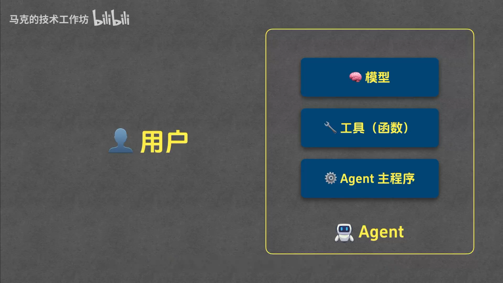
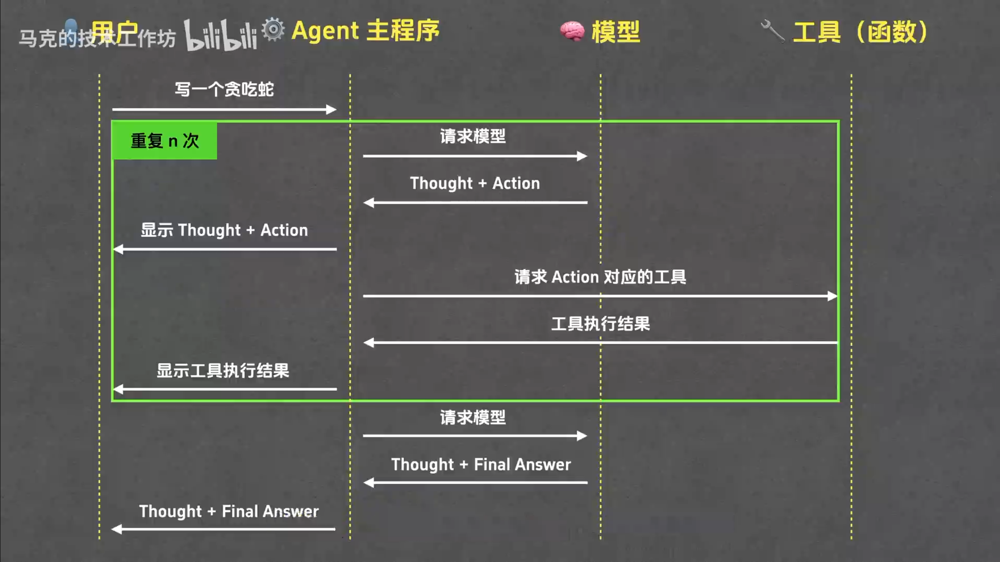
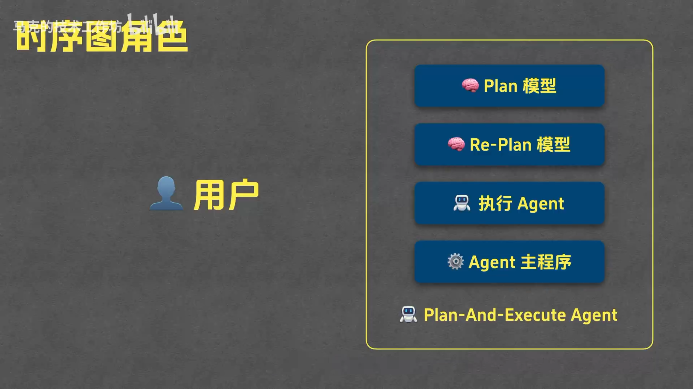
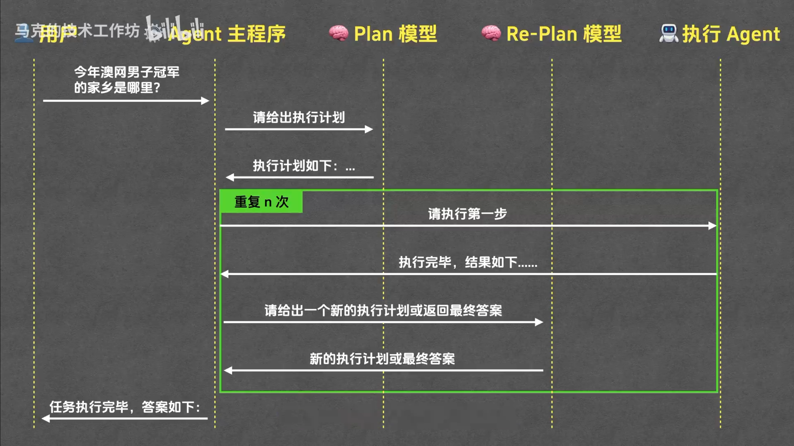

# Agent

## Agent 运行模式

### 1. ReAct 模式（Reasoning and Acting)

#### 1. React 模式的运行流程

#### 2. React 系统提示词（模型角色，运行规则，环境信息）

#### 3. React 时序图角色

#### 4. React 运行时序图

### 2. Plan-and-Execute 模式（先规划，再执行）

#### 1. Plan-and-Execute 时序图角色

#### 2. Plan-and-Execute 运行时序图

##### 1. 三轮循环（执行 Agent -> Re-Plan 计划）

###### 1. 第一轮

1. 执行 Agent

.png)

2. Re-Plan 计划

.png)

###### 2. 第二轮

1. 执行 Agent

.png)

2. Re-Plan 计划

.png)

###### 3. 第三轮

1. 执行 Agent

.png)

2. Re-Plan 计划

.png)